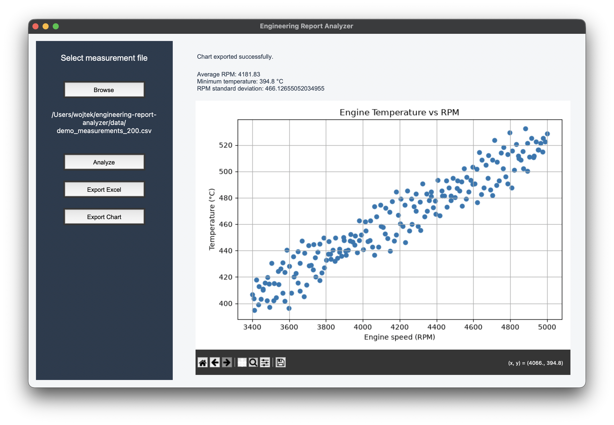

# Engineering Report Analyzer

A Python application for loading, validating and analyzing engine measurement data.

The project includes a desktop GUI built with Tkinter, basic statistical analysis and report export.

## Screenshot



## Features

- Import measurement data from CSV and JSON files
- Validate records and track rejected measurements
- Calculate average RPM, minimum temperature and RPM standard deviation
- Display an interactive temperature vs RPM chart
- Export analysis results to Excel
- Export charts to PNG
- Run the application in GUI or CLI mode

## Requirements

- Python 3
- Tkinter support

### Setup on macOS / Linux

Create and activate a virtual environment:

```bash
python3 -m venv .venv
source .venv/bin/activate
```

Install dependencies:

```bash
python -m pip install -r requirements.txt
```

### Setup on Windows

```powershell
py -m venv .venv
.\.venv\Scripts\Activate.ps1
python -m pip install -r requirements.txt
```

## Running the application

Start the GUI:

```bash
python main.py
```

Select a CSV or JSON file using the Browse button, then click Analyze.

The application displays the analysis results and an interactive chart. Reports and charts can be exported using the buttons on the left.

## CLI mode

The application can also run without the GUI:

```bash
python main.py --cli
```

Currently, CLI mode uses the default CSV file configured in `main.py`.

## Sample data

Example measurement files are available in the `data` directory:

- `measurements.csv` – small CSV dataset containing valid and invalid records
- `measurements.json` – sample JSON dataset
- `demo_measurements_200.csv` – larger dataset for chart visualization
- `invalid.json` – malformed JSON file for error handling tests

The demo data is synthetic and intended for testing.

## Tests

Tests are written using pytest.

Run all tests:

```bash
python -m pytest -v
```

Tests cover measurement validation, CSV/JSON loading and statistical calculations.